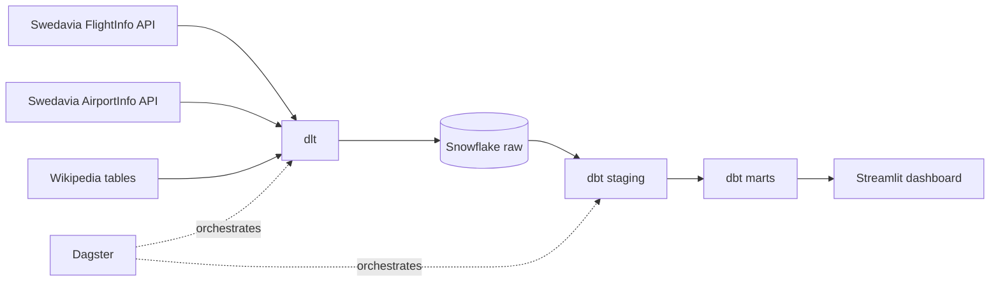
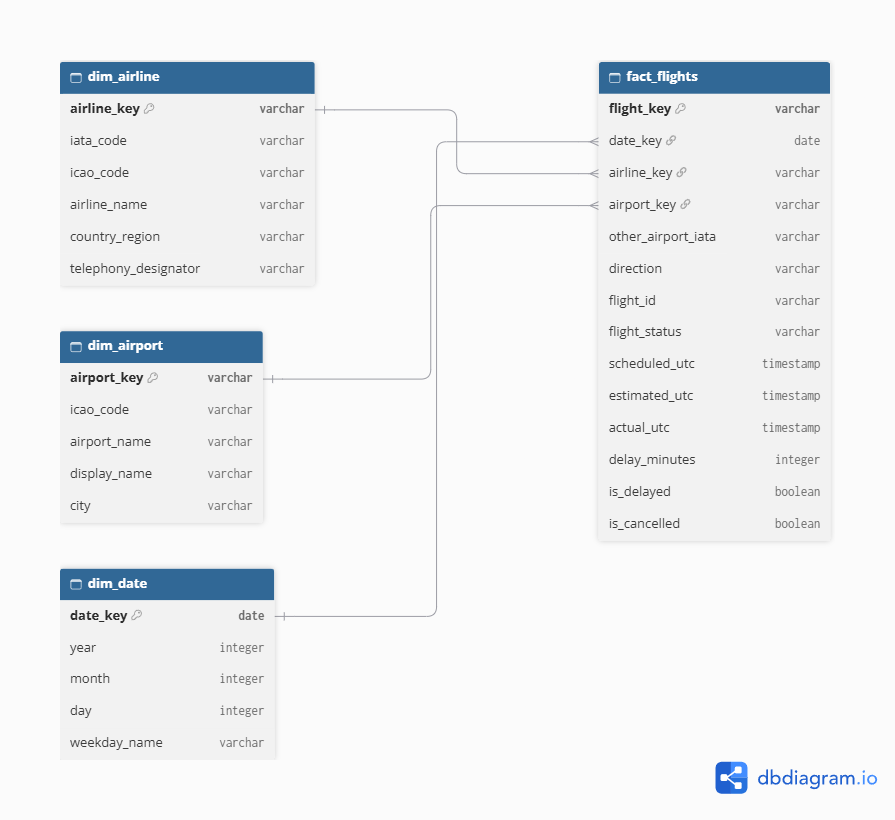

# Flight Punctuality Analytics


This is a proof of concept of a modern data stack for a hypothetical Swedish airport authority. It answers one question: **how many arrivals and departures are delayed, and at which airports, on which dates and with which airlines?**

I pull flight data from the Swedavia APIs and reference data from Wikipedia, load it into Snowflake with dlt, model it with dbt, show it in a Streamlit dashboard and run the whole chain with Dagster.

## Contents

- [The stack](#the-stack)
- [How the data flows](#how-the-data-flows)
- [Data sources](#data-sources)
- [Data model](#data-model)
- [Business rules](#business-rules)
- [Snowflake access control](#snowflake-access-control)
- [Repository structure](#repository-structure)
- [Setup](#setup)
- [Running the pipeline](#running-the-pipeline)
- [Running the dashboard](#running-the-dashboard)
- [Tests](#tests)
- [Limitations](#limitations)

## The stack

| Step | Tool | What it does here |
|---|---|---|
| Loading | dlt | Calls the APIs and Wikipedia and writes the raw data to Snowflake |
| Warehouse | Snowflake | Stores the raw, staging and marts layers |
| Transformation | dbt core | Cleans the data and builds the dimensional model, with tests |
| Visualisation | Streamlit | Dashboard for the business stakeholders |
| Orchestration | Dagster | Runs the loads and the dbt steps in the right order |

## How the data flows



1. **Extract and load.** dlt fetches arrivals and departures for all Swedavia airports for the past three days (including the day of the run), the airport list, and two Wikipedia tables. Everything is written to the `raw` schema in Snowflake.
2. **Staging.** dbt cleans each raw table in the `staging` schema. It renames columns, removes duplicate flights and puts arrivals and departures into one table.
3. **Marts.** dbt builds the dimensional model in the `marts` schema: one fact table and three dimensions.
4. **Dashboard.** Streamlit reads the marts and shows delays by date, airport and airline.
5. **Orchestration.** Dagster runs the Swedavia load and the Wikipedia load, then `dbt run`, then `dbt test`.

## Data sources

| Source | Used for |
|---|---|
| Swedavia FlightInfo v2, `arrivals` and `departures` endpoints | The flights themselves, with scheduled, estimated and actual times |
| Swedavia AirportInfo v2, `airports` endpoint | The list of airports, so the code does not need a hard-coded list |
| Wikipedia, [List of airline codes](https://en.wikipedia.org/wiki/List_of_airline_codes) | Airline country and telephony designator |
| Wikipedia, [List of international airports by country](https://en.wikipedia.org/wiki/List_of_international_airports_by_country) | City for each airport |

The Swedavia API covers the ten airports that Swedavia operates:

| Code | Airport | Code | Airport |
|---|---|---|---|
| ARN | Stockholm Arlanda | KRN | Kiruna |
| BMA | Stockholm Bromma | LLA | Luleå/Kallax |
| GOT | Göteborg Landvetter | OSD | Åre Östersund |
| MMX | Malmö | RNB | Ronneby |
| UME | Umeå | VBY | Visby |

One run makes 61 API calls: 10 airports x 2 directions x 3 days for the flights, plus 1 call for the airport list.

Raw tables in the `raw` schema: `arrivals`, `departures`, `airports`, `wikipedia_airlines` and `wikipedia_airports`. dlt also creates a few helper tables of its own, which start with `_dlt`.

## Data model



The diagram was drawn in dbdiagram.io. Its source is in `docs/data_model.dbml`. After drawing it I added three columns from Wikipedia: `country_region` and `telephony_designator` in `dim_airline`, and `city` in `dim_airport`.

**`fact_flights`** has one row per flight, either an arrival or a departure, at one of the ten airports.

| Column | Meaning |
|---|---|
| `flight_key` | Unique key built from airport, direction, flight id, departure date and both airport codes |
| `date_key` | Scheduled date in Swedish time, links to `dim_date` |
| `airline_key` | Airline ICAO code (IATA code if missing), links to `dim_airline` |
| `airport_key` | Airport IATA code, links to `dim_airport` |
| `other_airport_iata` | The airport at the other end of the flight |
| `direction` | `arrival` or `departure` |
| `flight_id`, `flight_status` | Flight number and status in English |
| `scheduled_utc`, `estimated_utc`, `actual_utc` | The three timestamps |
| `delay_minutes` | Minutes later than scheduled (negative if early) |
| `is_delayed` | True if more than 15 minutes late |
| `is_cancelled` | True if cancelled or removed |

**`dim_airline`:** `airline_key`, `iata_code`, `icao_code`, `airline_name`, `country_region`, `telephony_designator`

**`dim_airport`:** `airport_key`, `icao_code`, `airport_name`, `display_name`, `city`

**`dim_date`:** `date_key`, `year`, `month`, `day`, `weekday_name`

## Business rules

- **Delayed** means more than 15 minutes later than scheduled. I compare the scheduled time with the actual time, and with the estimated time when there is no actual time yet. 15 minutes is the usual threshold in aviation.
- **Early flights** get a negative `delay_minutes` and are not counted as delayed.
- **Cancelled or removed** means the status is `Cancelled` or `Deleted`. Swedavia marks most removed flights as `Deleted`, so the dashboard calls this group "Cancelled or removed". These flights have no delay value and are left out of the delay numbers.
- **Unknown delay.** Flights with no estimated or actual time have no delay value. They are not counted as on time, and they are left out when the delay rate is calculated.
- **Delay rate** is delayed flights divided by flights with a known time.
- **Dates** use Swedish local time (Europe/Stockholm), because that is how the airports see a day.
- **Duplicates.** The loads append, so the same flight can be loaded many times. Staging keeps one row per `flight_key`, the one from the most recent load.
- **Airlines** are matched to Wikipedia on the ICAO code. The Wikipedia list contains historic airlines and repeated IATA codes, so I keep one row per ICAO code.

## Snowflake access control

Each tool has its own user and its own role, with only the access it needs. Nothing runs as `ACCOUNTADMIN`.

| User | Role | Access |
|---|---|---|
| `dlt_user` | `loader_role` | Creates and writes tables in `raw` |
| `dbt_user` | `transformer_role` | Reads `raw`, full access to `staging` and `marts` |
| `streamlit_user` | `reporter_role` | Reads `marts` only |

All three roles are granted to `SYSADMIN`. The warehouse `flights_wh` is size X-Small and suspends after 60 seconds, to save credits. The users are created as service users, because they log in from code with a password. Each user has its own password. All credentials live in `.env`, which is never committed.

The whole setup is in `docs/snowflake_setup.sql`.

## Repository structure

```text
ingestion/        dlt sources and pipelines for Swedavia and Wikipedia,
                  plus small scripts for checking the connection and the API responses
transformation/   dbt project: staging and marts models, tests, profile
dashboard/        Streamlit app (db.py for the connection, metrics.py for the
                  calculations, app.py for the page)
orchestration/    Dagster definitions
docs/             data model diagram, its source and the Snowflake setup script
.env.example      the settings the project needs, without any values
requirements.txt  Python packages
```

## Setup

I developed this on Windows with Git Bash and Python 3.14.

**1. Clone the repository and install the packages**

```bash
git clone https://github.com/McodexD/flight-punctuality.git
cd flight-punctuality
python -m venv .venv
source .venv/Scripts/activate
pip install -r requirements.txt
```

On macOS or Linux the activation line is `source .venv/bin/activate`.

**2. Set up Snowflake**

Create a Snowflake trial account and run `docs/snowflake_setup.sql` in a SQL file. Replace the three placeholder passwords first and use a different one for each user. Your passwords must be long enough for Snowflake's password policy.

**3. Get the Swedavia keys**

Sign up at the Swedavia developer portal and subscribe to two products: FlightInfo and AirportInfo. Each subscription has its own key, and a key only works for its own API.

**4. Create the `.env` file**

Copy `.env.example` to `.env` and fill in every value. Use the account identifier in the form `organisation-account` for `SNOWFLAKE_ACCOUNT`.

```bash
cp .env.example .env
```

**5. Check the connection (optional)**

```bash
python -W ignore ingestion/test_connection.py
```

It should print `('DLT_USER', 'LOADER_ROLE', 'FLIGHTS_WH', 'FLIGHTS_DB')`.

## Running the pipeline

### With Dagster

```bash
export DAGSTER_HOME="$PWD/.dagster_home"
dagster dev -f orchestration/definitions.py
```

Open http://127.0.0.1:3000, go to **Lineage** and click **Materialize all**. Four assets run in this order:

1. `swedavia_raw` and `wikipedia_raw` (in parallel)
2. `dbt_models`
3. `dbt_tests`

A full run takes about 1.5 minutes. The job is called `flight_pipeline`. A daily schedule for 06:00 Swedish time is also defined and is active while Dagster is running. The run history is stored in `.dagster_home`, which git ignores.

### Step by step without Dagster

```bash
python -W ignore ingestion/pipeline.py
python -W ignore ingestion/wikipedia_pipeline.py
dotenv run -- dbt run --project-dir transformation --profiles-dir transformation
dotenv run -- dbt test --project-dir transformation --profiles-dir transformation
```

`dotenv run --` loads the `.env` file for the dbt commands.

## Running the dashboard

```bash
streamlit run dashboard/app.py
```

It opens at http://localhost:8501. The dashboard shows:

- the number of flights, delayed flights, the delay rate and cancelled or removed flights
- delayed flights and delay rate by date, split into arrivals and departures
- delayed flights and delay rate by airport
- delay rate by airline, with a table of airline details

In the sidebar you can filter on date, direction and airport, and set the minimum number of measured flights an airline needs to be shown. This keeps airlines with only a few flights from topping the list.

## Tests

dbt runs 15 tests. Staging checks that `flight_key` and `airport_iata` are unique and not null. The marts check that all keys are unique and not null, and that every flight in `fact_flights` points to an existing airline, airport and date. The tests run as the last step in Dagster, or with `dbt test`.

## Limitations

- The Swedavia free plan allows 10,001 requests per 30 days. One run uses 61.
- Flights on the current day have few estimated or actual times, so the delay numbers are most reliable for earlier days.
- Only the three most recent days are loaded, so the data does not build up a longer history over time.
- The Wikipedia airport list only covers international airports, so Kiruna and Ronneby have no city.
- Small airports can show a delay rate of 0 % or no bar at all. This is usually because they have very few flights with a known time.
- The Snowflake connector prints a harmless warning about the version of pyarrow.
